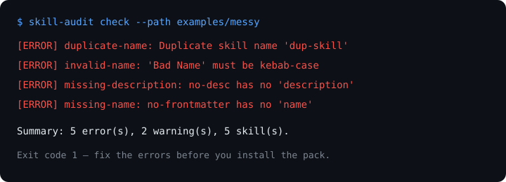

# skill-audit

Your agent skills pack is growing. Which skills are duplicates? Which ones fight over the same trigger? Which ones have no description, so the agent never picks them?

`skill-audit` answers those questions in one command, with zero dependencies.

## Why

Agent Skills packs are exploding — every week brings new packs, and teams copy skills from several sources into one folder. The result:

- Two skills with the **same name** — the agent picks one arbitrarily.
- Two skills with **near-identical descriptions** — both trigger on the same prompt, so you get random behaviour.
- Skills with **no description** — the agent never triggers them, because the description is how it decides.
- Skills with **invalid names** or no frontmatter — silently ignored by some loaders.
- Packs with **no version** — nobody knows whether they have the latest.

Existing skill packs add more skills. `skill-audit` tells you whether the ones you already have are healthy.

## What it checks

| Check | What it finds |
|---|---|
| Duplicate name | Two `SKILL.md` files declaring the same `name` |
| Invalid name | Names that are not kebab-case (`Bad Name`, `UPPER`, ...) |
| Missing name / description | Frontmatter without `name` or `description` |
| Missing frontmatter | `SKILL.md` with no `---` block at all |
| Duplicate / overlapping description | Identical descriptions, or ≥70% token overlap (Jaccard) |
| Description too short / too long | Under 20 chars, or over 1024 chars |
| Thin body | `SKILL.md` body under 50 chars — a header, not a skill |
| Missing `SKILL.md` | A folder with files but no `SKILL.md` — not discoverable |
| No version | No `version` in frontmatter — consider adding one |

Exit code `0` = no errors, `1` = errors found. Warnings never fail the run on their own.

## Demo



```text
$ skill-audit check --path examples/messy
[ERROR] duplicate-name: Duplicate skill name 'dup-skill'
[ERROR] invalid-name: 'Bad Name' must be kebab-case
[ERROR] missing-description: no-desc has no 'description'
[ERROR] missing-description: (unnamed) has no 'description'
[ERROR] missing-name: no-frontmatter/SKILL.md has no 'name'
[WARN ] frontmatter-parse: no-frontmatter/SKILL.md missing frontmatter block
[WARN ] no-version: (unnamed) has no 'version' in frontmatter
Summary: 5 error(s), 2 warning(s), 5 skill(s).
```

## Quick start (3 steps)

```bash
# 1. Clone
git clone https://github.com/techdevfun/skill-audit.git
cd skill-audit

# 2. No dependencies to install (Python 3.9+ stdlib only).
#    Optional: install the `skill-audit` command
pip install -e .

# 3. Audit your skills folder
PYTHONPATH=src python -m skill_audit check --path ~/.claude/skills
```

## Try it on the examples

```bash
# Clean pack — should pass
PYTHONPATH=src python -m skill_audit check --path examples/good

# Messy pack — should fail with errors
PYTHONPATH=src python -m skill_audit check --path examples/messy || true

# List what was found
PYTHONPATH=src python -m skill_audit list --path examples/good

# JSON for scripts / CI
PYTHONPATH=src python -m skill_audit check --path examples/messy --format json
```

### In CI

```yaml
- name: Audit skills pack
  run: PYTHONPATH=src python -m skill_audit check --path skills --format text
```

See `examples/ci/check.sh` for a ready wrapper. This repo runs the same checks in `.github/workflows/ci.yml` on Python 3.9, 3.11, and 3.12.

## Roadmap

- [ ] `--fix` to suggest a renamed duplicate and a rewritten description
- [ ] `--strict` to turn selected warnings into errors
- [ ] Check `allowed-tools` / permission fields for risky tool grants
- [ ] Report which skills are never triggered (needs usage logs)

## License

MIT — see [LICENSE](LICENSE).
